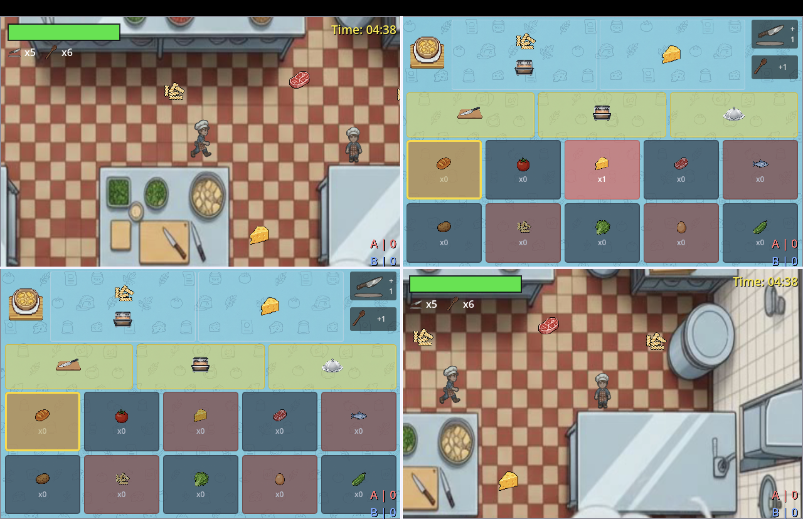

# Cook & Crook

Made in 2 days by a team of two for the Shift Gaming Club game jam at Reichman University. I worked on game design, gameplay programming and level design. Developed with AI-assisted coding (Cursor).

A 4-player couch co-op / versus cooking game made with **Godot 4.6**.

Two teams race to cook the same dish. On each team, one player is the **Gatherer**, running around a shared kitchen to grab ingredients and fight off the other team, and one player is the **Chef**, who preps and plates the order back at the station. The team with the most points when the clock runs out wins.



**Play it on itch.io:** [https://saarhurvitz.itch.io/cook-n-crook](https://saarhurvitz.itch.io/cook-n-crook)

## How to play

The screen is split into four quadrants, one per player. Both gatherers run around the same kitchen map, while each chef has their own station.

### Gatherer
- Run around the kitchen and pick up ingredients. Everything you collect lands in your chef's pantry.
- Throw **knives** at the other gatherer, and swing your **spoon** at close-range targets.
- Watch out for **monsters**. They start showing up as the match goes on, with a final wave near the end.
- If your health runs out, you're locked out for 10 seconds and your chef loses some ingredients from the pantry.

### Chef
- Pick an ingredient from the pantry and choose what to do with it: **Cut**, **Cook**, or put it straight on the **Serve** plate.
- When the plate matches the current order, the finished dish appears — **Deliver** it for **+10 points**.
- Delivering the wrong dish costs **-10 points**.
- Some dishes (the toasts) are made by putting the ingredients on the plate and using **Cook all**.
- Send extra **knives** and **spoon** charges to your gatherer with the buttons in the top-right corner.

Both chefs work on the same order. As soon as one team delivers it, a new order is drawn for everyone.

### Dishes

| Dish | Ingredients |
|---|---|
| Fish & Chips | cooked fish, cut potato |
| Burger | bread, cooked meat, cut lettuce, cut tomato |
| Cheese Burger | bread, cooked meat, cut lettuce, cut tomato, cheese |
| Cheese Pasta | cooked pasta, cheese |
| Tomato Pasta | cooked pasta, cut tomato |
| Cheese Tomato Pizza | bread, cut tomato, cheese |
| Meat Pizza | bread, cut tomato, cheese, cooked meat |
| Salad | cut cucumber, cut tomato, cut lettuce |
| Egg Toast | eggs + bread, cooked together |
| Tomato Cheese Toast | bread + cheese + cut tomato, cooked together |

## Controls

The game is built for PS5 DualSense controllers (other gamepads work too). One player can use the keyboard.

| Action | Controller | Keyboard / Mouse |
|---|---|---|
| Join the lobby | Any button | Enter / Space |
| Pick team & role in the lobby | Left stick / D-pad | WASD / Arrow keys |
| Start the match | ✕ (Cross) | Enter / Space |
| Move (gatherer) / navigate (chef) | Left stick / D-pad | WASD / Arrow keys |
| Throw knife (gatherer) | □ (Square) | Right mouse button |
| Swing spoon (gatherer) | ○ (Circle) | F |
| Select / confirm (chef) | ○ (Circle) | Enter / Space |
| Restart after a match | ✕ (Cross) | Enter / Space |

## Running the project

1. Install [Godot 4.6](https://godotengine.org/download).
2. Clone this repository.
3. Open Godot, choose **Import**, and select the `project.godot` file.
4. Press **Play** (F5).

To build a standalone app, use **Project → Export** with the included presets.

## Project structure

```
scenes/     Game scenes (main, maze, characters, UI)
scripts/    GDScript code
  autoload/   Global singletons (game state, events, audio)
  chef/       Chef station, pantry and plating logic
  gatherer/   Gatherer movement, combat and animations
  maze/       Kitchen map and ingredient spawning
  enemies/    Monsters
  weapons/    Knife and spoon
  core/       Split-screen and input routing
  ui/         Lobby and HUD
assets/     Art, audio and video
```
